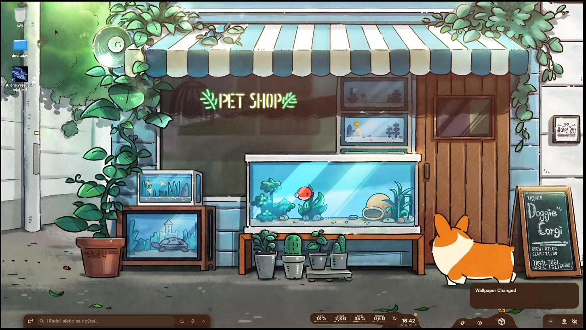
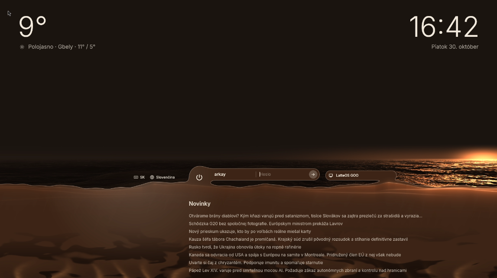
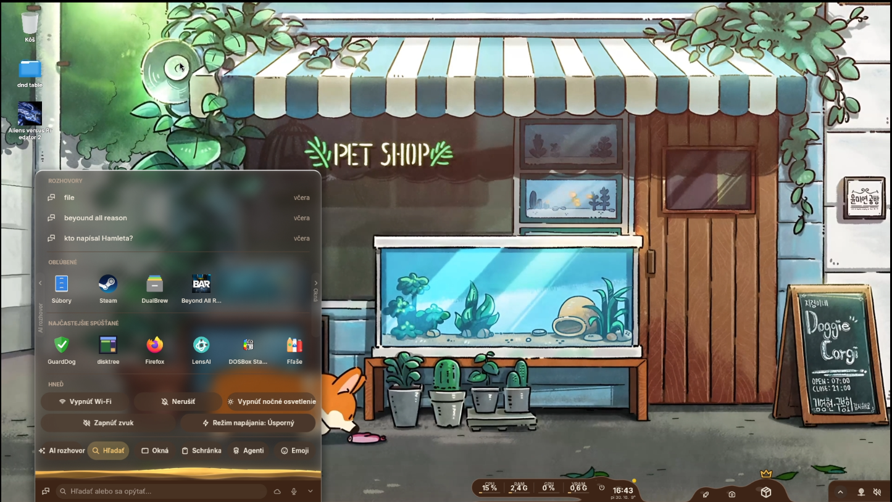
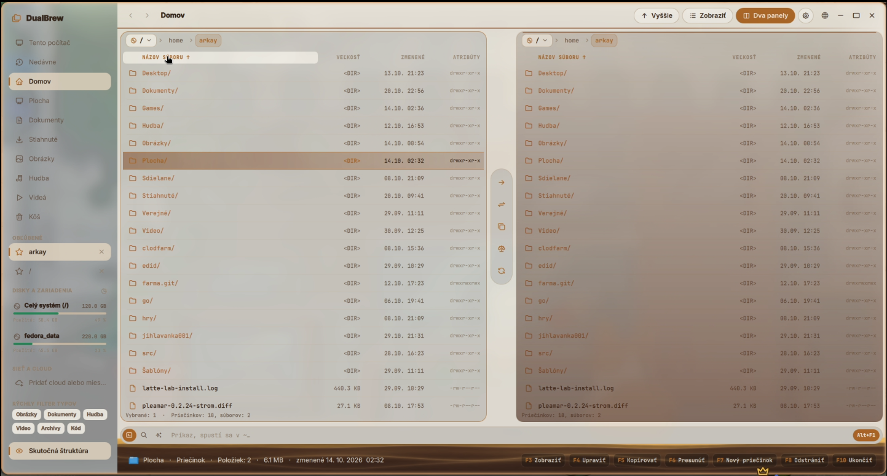
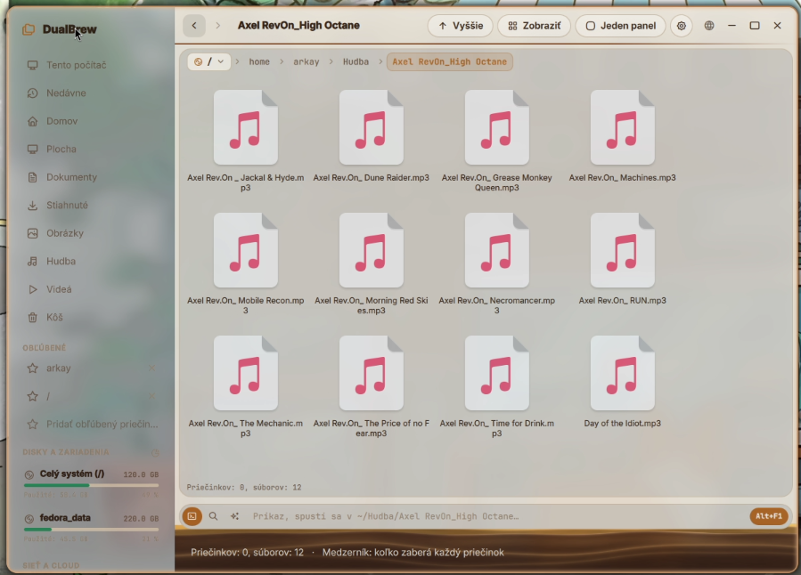
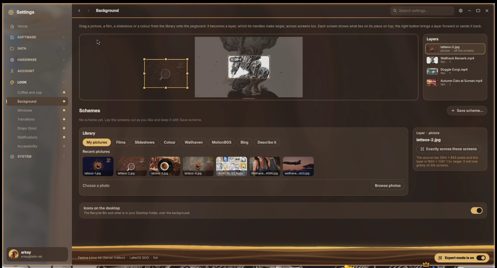
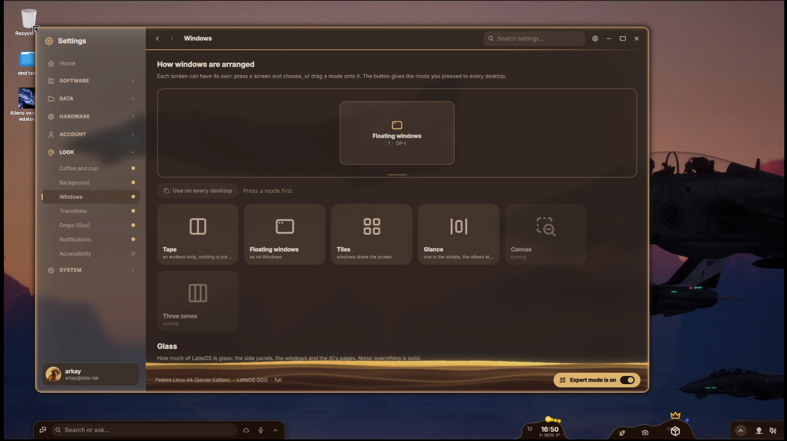
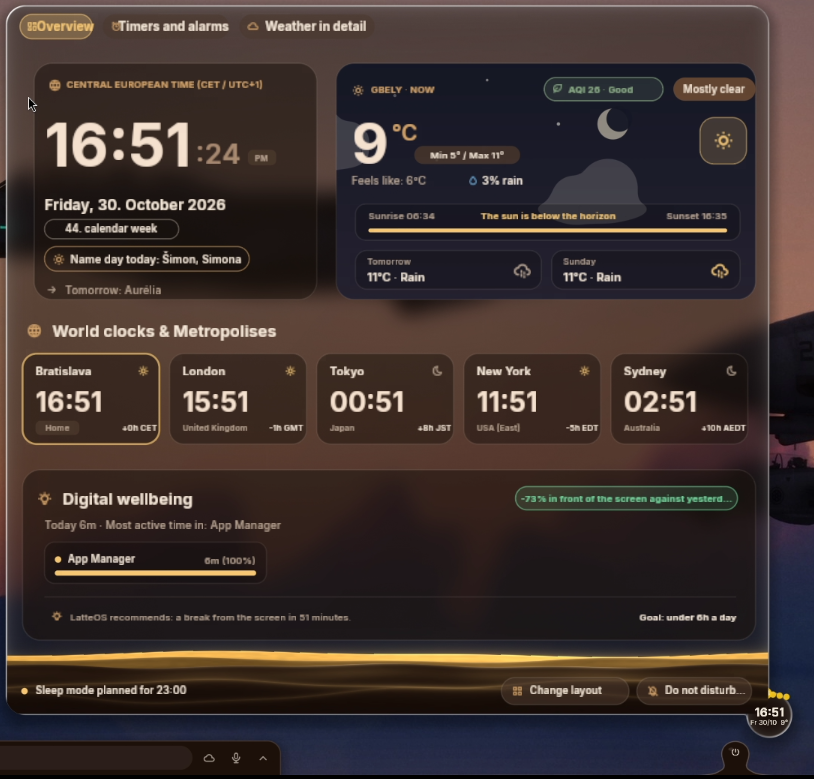
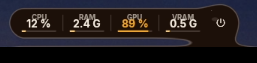

# LatteOS — Jihlavanka (0.x)

**A Linux desktop for people coming from Windows — made of liquid coffee.**

LatteOS is a desktop built on Fedora and [pleamar-wm](https://github.com/k4ditano/pleamar-wm) for people who know Windows, want a computer that is simply
theirs, and never want to open a terminal. The taskbar, Start menu, clock and system tray are replaced by
**liquid coffee droplets ("goo")** that stretch, stick to the screen edge and react to the cursor. Everything
works with the mouse; keyboard shortcuts are a bonus, never a requirement.

> **Status: early development (0.x "Jihlavanka").** Things change daily and can break. Install it on a test
> machine only. The first stable release will be 1.0 "Arabica".

## New in 0.5: from Hyprland to pleamar-wm

This branch replaces Hyprland with [pleamar-wm](https://github.com/k4ditano/pleamar-wm), a Wayland compositor whose window
manager is itself a pleamar scene. The Goo engine already ran on pleamar, so the drops barely change; what changes is the layer
of windows beneath them. In return the window manager, its effects and the canvas can be rewritten like any other scene, the
Hyprland plugins go away, and agents get what the compositor is built around: a pointer and keyboard of their own that leave
yours alone, rules for what they may touch, and a gate for what they ask to do.

**This is a work in progress.** The session starts from the login screen with the Goo engine, wallpaper and window commands
(list, focus, minimize, maximize, close), while window modes, snapping, glass and LatteOS's own shortcuts are still being moved
over. Hyprland stays as the other session until the new one can do everything it did, and `v0.4-fresh` remains the way back.
It was tested on one machine with a Fedora 45 beta. AMD GFX6 to GFX8 cards (such as the RX 640 it was tested on) need Linux 7.3
and Mesa 26.3, still a release candidate; without them the drops are painted by the processor.

**Thanks to** [k4ditano](https://github.com/k4ditano), the author of [pleamar](https://github.com/k4ditano/pleamar),
pleamar-wm and [Marea](https://github.com/k4ditano/marea-plm); to the rice community on Reddit; to Claude Opus 5.5, which wrote
this migration; and to the greed of corporations, without which nobody would have needed a system like this.

## The Goo engine

Goo is an environment built on pleamar: liquid drops of coffee that seem to float in low gravity and have a life of their own.
Each one has its own job and reacts to you, and even to your being away. The cursor draws them in and lights them. The screen's
edges are sticky to them, and so are they to each other, while the bottom edge is a rippling surface of coffee that they fall
into. Coffee this alive is really more of a slime, an ooze straight out of a D&D fantasy.

The inspiration is exactly that: *Homebrew*, a tiny coffee ooze by Fluffy (The Fluffy Folio), posted on Reddit by michifromkmk.
 

## How it is made

LatteOS is designed by **Arkay** (Slovakia) — the ideas, look and behaviour. The code is written together with an
AI assistant (**Claude** by Anthropic). We say this openly: every feature is described, reviewed and tested by a
human on a real PC, and borrowed code is always credited (see *Credits* below).

## What it looks like

| | |
|---|---|
|  **Login** — a coffee sea at sunset, weather, clock and news. Live Sun, Moon and Stars. |  **LensShore** — search, apps, quick actions, clipboard, emoji and AI in one bar. |
|  **DualBrew** — two-panel file manager (Total Commander habits, Windows looks). |  **DualBrew** — single panel with icons. |
|  **Background** — the *pegboard*: drag pictures, films or slideshows onto your screens as layers. |  **Windows** — each screen chooses how windows are arranged: floating, tape, tiles, glance. |
|  **ClockGoo** — time, weather, world clocks, digital wellbeing. |  **PowerGoo strip** — CPU, RAM, GPU and VRAM at a glance. |

## What makes it different

- **Mouse first, Windows habits.** No feature is reachable only by keyboard or terminal. Right-click works
  everywhere, always with the same menu order.
- **Liquid desktop (Goo).** The shell is a set of droplets drawn by [pleamar](https://github.com/k4ditano/pleamar):
  they move, merge and breathe. Glass, metal and coffee themes; a plain *FPS* theme with no effects for gaming.
- **The pegboard.** Your monitors laid out as they really stand on the desk — for cursor movement, window
  modes per screen and wallpapers stretched across screens (pictures, videos, slideshows).
- **NET button.** Cut any app off the internet instantly — Windows apps too.
- **Made for games.** Steam, Proton and current drivers; **Barista** prepares Windows programs and games for you.
- **AI you can switch off.** Local AI (also in Slovak or another languahe) can help with settings and files; online AIs live in their
  own tabs. Generative AI can be turned off completely in the installer or in Settings.
- **No telemetry, no ads, no account required.**

## Platform

- Fedora 44 + Hyprland, Quickshell (QML) apps, Pleamar, Rust tools; Fedora Atomic (bootc) planned for 1.0.
- Must boot without a GPU: a **SAFE** session (labwc) always works; acceleration only adds effects.
- Target: any PC with Vulkan that is less than ~10 years old, AMD, NVIDIA and Intel.

## Credits

LatteOS stands on other people's work. Every borrowed project, file, shader, font and icon is listed — who made it,
what LatteOS uses it for and under which licence — in [TRETIE-STRANY.md](TRETIE-STRANY.md). Highlights:
[pleamar](https://github.com/k4ditano/pleamar), [Hyprland](https://github.com/hyprwm/Hyprland),
[Hyprglass](https://github.com/hyprnux/hyprglass), [Quickshell](https://github.com/quickshell-mirror/quickshell),
[skwd-wall](https://github.com/liixini/skwd-wall), [whyd](https://github.com/vmaltarello/whyd),
[labwc](https://github.com/labwc/labwc), [Tabler Icons](https://github.com/tabler/tabler-icons).

Wallpapers in the screenshots belong to their artists and are not part of LatteOS.

## Licence

MIT for LatteOS's own code for now ([LICENSE](LICENSE)). The final licence will be chosen before 1.0 so that
it fits every borrowed part.

---

*Slovensky:* LatteOS je linuxová plocha pre ľudí z Windowsu, z tekutých kávových kvapiek, ovládaná myšou.
Navrhuje ju Arkay, kód vzniká s pomocou AI (Claude). Raný vývoj — iba na testovací počítač.
